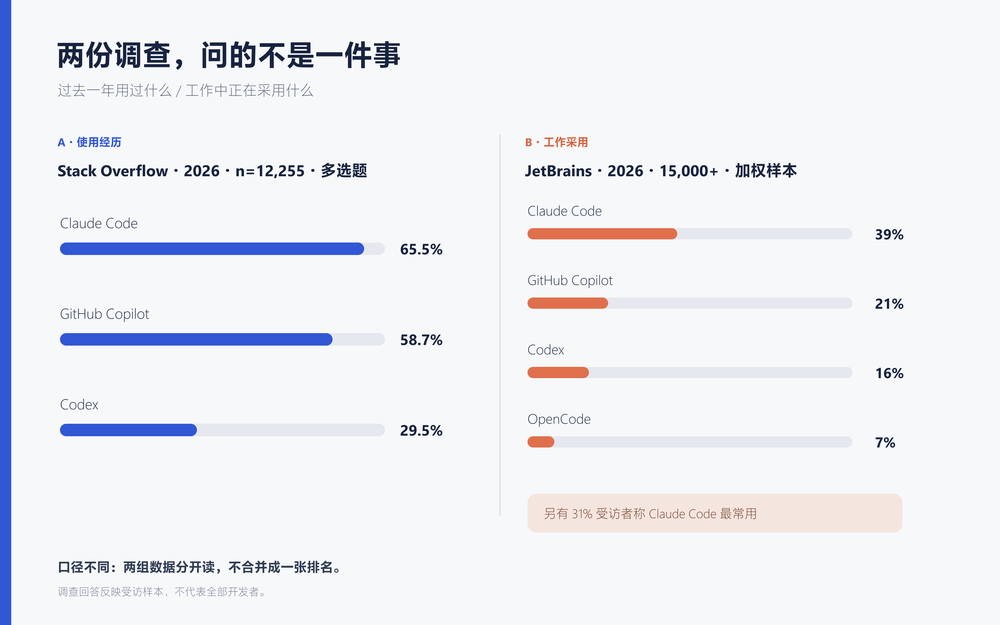
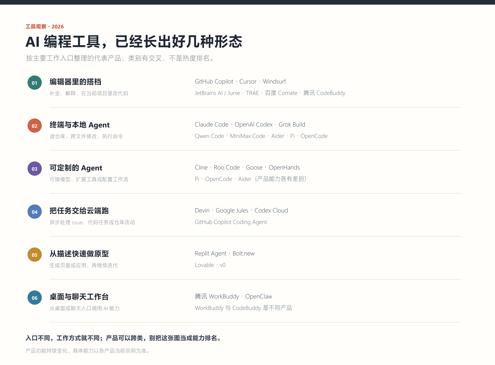
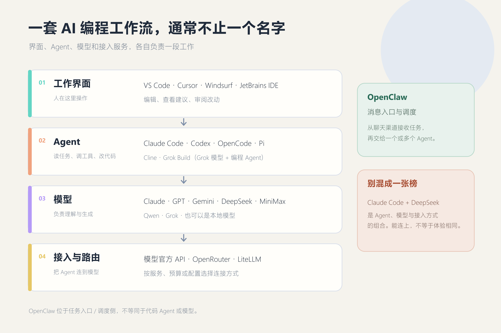
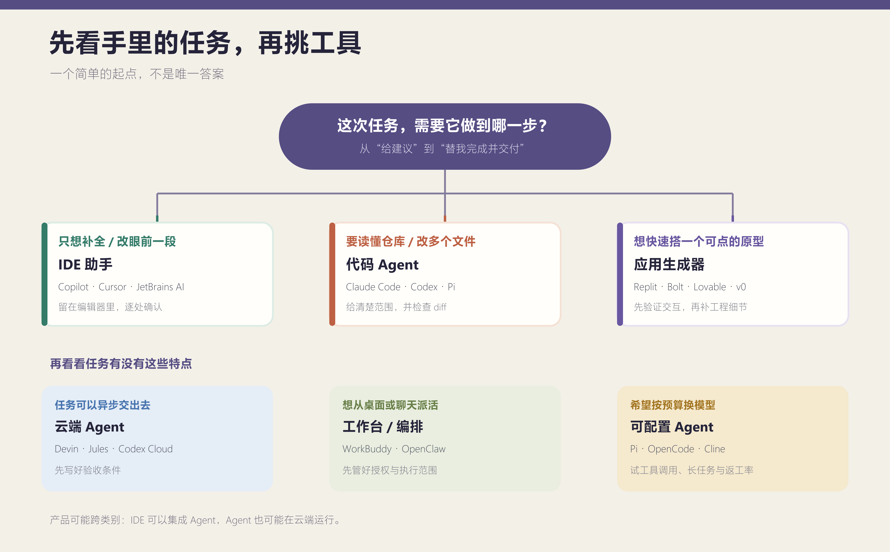

# 人人都是产品经理投稿稿

## 标题备选

1. **推荐：AI 编程工具这么多，大家到底都在用什么？**
2. Claude Code、Codex、Cursor：这几个工具到底有什么区别？
3. 最近在看 AI 编程工具，我想知道大家平时怎么用

## 正文

最近我琢磨的是自己的用法：复杂任务继续让 Claude Code 配 Claude，小改动换 DeepSeek Flash，省些成本。

后来刷 X、看产品介绍，我又碰到一堆别的玩法：有人用 Codex 同时跑几个 Agent，有人把 Pi 接到 MiniMax，还有人从聊天软件里给 OpenClaw 派任务。名字都跟 AI 编程有关，可它们做的事并不一样。有的在编辑器里帮你补几行代码，有的会读仓库、改文件、跑命令，还有的负责把任务转给别的 Agent。

刷了一阵 X，我发现越新奇的用法越容易被转发。至于大家每天工作时到底开着什么，光看帖子反而看不清。我就去翻了开发者调查，想看看时间线之外是什么情况。

## 我翻了两份调查，题目差别挺大

Stack Overflow 的 2026 开发者调查问的是“过去一年用过哪些编码 Agent 或助手”。这是多选题。在 12,255 名选了“用过”的回答者里，65.5% 选了 Claude Code，58.7% 选了 GitHub Copilot，29.5% 选了 Codex。

这个结果说明不少开发者接触过这些工具，不能当作每天使用的排名。一个人一年里试过 Copilot、Cursor 和 Claude Code，都可以分别选上。

JetBrains 问的是专业开发者在工作中用哪些工具。它在 2026 年 5 月到 7 月收集了 15,000 多份答卷，报告经过样本加权。工作采用率里，Claude Code 约 39%，Copilot 21%，Codex 16%，OpenCode 7%；31% 的受访者说 Claude Code 是自己最常用的 AI 编程工具。JetBrains 自己也做 IDE 和 AI 产品，这不是第三方横评。我看这组数字时，也会一起看它的样本和加权方法。

所以我把两组数字分开摆。Claude Code、Copilot 和 Codex 在两份调查里都不靠后，但不能把 Stack Overflow 的 65.5% 和 JetBrains 的 39% 当成一场比赛。X 上谁的帖子多也是另一回事。愿意晒工作流的人更容易被看见，光刷帖子猜不出日常使用的人数。

## 工具多，不等于它们在抢同一个位置

我把这轮看到的产品按“主要从哪里开始工作”放进一张图里。这个分法只是为了看清它们各自解决什么问题，不是市场排名；同一个产品也可能跨几类。比如 Cursor 既是编辑器，也在不断增加 Agent 能力；Pi、OpenCode 这类工具则更适合愿意自己挑模型、配工作流的人。

图里的工具很多，我不打算挨个做功能评测，先把几条容易混淆的路线说清楚。

## AI 在不同工具里，做的事不一样

### 在编辑器里随手问、随手改

GitHub Copilot、Cursor、Windsurf、JetBrains AI Assistant 和 Junie 都从开发者熟悉的编辑器或 IDE 进入。国内也有 TRAE、百度 Comate、腾讯 CodeBuddy。它们能做的事并不完全一样，但这条路线的共同点是：代码和建议就在眼前，开发者可以边看边决定采不采纳。

好处是不用先改变整套开发习惯。团队真正要看的，往往也不只是它某次生成得快不快：它能不能拿到合适的项目上下文，权限怎么管，生成的修改能不能顺利进入原来的代码评审流程，这些都影响它最后有没有人愿意用。

### 让代码 Agent 自己跑一段

Claude Code、OpenAI Codex、Grok Build、Qwen Code、MiniMax Code 等会进入项目上下文，按任务读文件、改动代码，有些也能运行命令，再把结果交回来。它们的授权方式、模型选择和运行环境各不相同，不能只看产品名字就默认能力相同。比起补全一行代码，它们更像是接手一件具体工作：修一个问题、完成一组改动，或先把某个模块摸清楚。

这时“做完了”不能只听它自己说。文件有没有改对、测试是不是真的跑过、有没有顺手动到别的地方，最后还是得有人检查。把任务拆开同时交给几个 Agent，确实可能更快；但要是没人负责最后的合并和验收，省下来的时间很快又会花在审查上。

Claude Code 的创建者 Boris Cherny 分享过自己并行运行多个 Claude 会话、也使用云端会话的做法。他提到要让 Agent 有办法验证结果。我觉得这比“同时开几个”更值得记下来：让 Agent 多做一步，人就要多想一步怎么确认它做对了。这是他的个人工作流，不能拿来代表所有开发者。

### 想换模型，也得愿意自己折腾

Pi、OpenCode、Cline、Roo Code、Aider、Goose 和 OpenHands，给了用户不同程度的模型选择和工作流定制空间。Pi 这里说的是 Mario Zechner 维护的 pi-mono 里的终端 coding agent，不是同名聊天产品。把 Pi 接到 MiniMax，是用户自己组合 Agent 与模型的用法；我没有找到双方官方合作的说法，所以不把它写成官方套餐。

这种自由适合愿意动手配置的人。接入之后能不能稳定调用工具、长任务会不会中断、出错后能不能恢复，都得拿自己的项目试。省下的模型费用，也要和调试、检查、返工的时间一起算。

这里有几个名字经常被混在一起说。Claude Code、Codex、OpenCode、Pi 属于 Agent 或执行工具，负责理解任务、调工具、改代码；Claude、GPT、Gemini、DeepSeek、MiniMax、Qwen、Grok 是模型；OpenRouter、LiteLLM 这类服务则负责把工具接到模型或做路由。IDE 是开发者平时工作的界面。

所以“Claude Code 接 DeepSeek”说的是一个组合。能连上不代表用起来就一样：模型能不能正确调用工具、任务长了会不会跑偏、出错后能不能接着做，这些都影响日常体验。价格低是个优点，但要是经常返工，也未必真省钱。

### 异步任务、快速原型和桌面工作台

Devin、Google Jules、Codex Cloud、GitHub Copilot Coding Agent 这类云端产品，可以把任务交给远端环境处理，适合不需要一直盯着的工作。Replit Agent、Bolt.new、Lovable 和 v0 则更靠近“先用一句话搭出可交互的应用或页面，再边看边改”。它们有时也能处理代码，但使用起点和交付方式，和在本地仓库里工作的终端 Agent 不一样。

还有一类工具从桌面或聊天入口开始。腾讯 WorkBuddy 面向办公、开发和创意等桌面工作；腾讯 CodeBuddy 是编程产品，两者名字相近，定位不同。OpenClaw 则能从聊天渠道接收任务并调度 Agent。它们可以进入开发流程，但不能简单等同于代码 Agent 本身。

## Grok Build、Pi 和 WorkBuddy，分别解决什么问题？

Grok 是模型品牌，Grok Build 是 xAI 的编程 Agent 项目。官方资料把它作为编程 Agent 介绍，并公开了源代码。看它时可以把问题拆开：我是否想用 Grok 相关模型能力？我是否需要它提供的代码工作流？这和在 Claude Code、Pi 等工具里选模型，是不同的选择层面。

Pi 的吸引力在于可组合：Agent 负责理解任务和调用工具，后端模型可以按个人配置选择。于是“Pi + MiniMax”更像一套自己搭的工作流，不是一个固定的官方产品组合。它给人的可控度更高，也把模型接入、上下文和工具稳定性这些功课交给了使用者。

WorkBuddy 则更像一个桌面工作入口。假如需求是让 AI 帮忙处理多个桌面场景，它的讨论重点会包括桌面授权、文件访问和跨应用操作；如果需求是写代码，CodeBuddy、Claude Code、Codex 等编程工具才是更直接的比较对象。产品名字相近，不代表它们互相替代。

把这些产品放到各自的位置后，很多“新组合”就没那么神秘了：有时只是换了模型，有时换了执行工具，也有时只是换了一个派活入口。

## Agent 开始改代码，产品得把过程露出来

编辑器里的 AI 通常把建议放在用户眼前，用户可以马上接受或忽略。代码 Agent 则可能连续读文件、修改项目、运行命令，最后才把结果交回来。它替用户做的事情变多了，产品就得把过程讲清楚。

用户至少得看见它读了哪些文件、准备改什么、执行过哪些命令。操作中要能停下来，改错了要能撤回；它说“测试通过”，也该看得到测试记录。什么都看不见，谁会放心让它碰真实项目？

所以我看 AI 编程产品，不会只盯着模型榜单。它有没有读对项目、过程中能不能看懂它做了什么、失败后能不能接着处理，这些更接近日常使用时会碰到的事。

## 我准备怎么试这套组合

如果只是改一段代码，我会先留在 IDE 里；如果要跨文件理解项目，再看代码 Agent；如果是想验证一个产品想法，先做原型的工具可能更省步骤；需要远程异步处理，再看云端 Agent。这个顺序不是标准答案，只是把“我要完成什么”放到“哪个模型最强”之前。

我还没打算把某一个模型定成所有任务的默认选项。接下来更想拿手边的实际工作试一试：小改动用 DeepSeek Flash，看看少花的钱会不会被返工抵消；跨文件、需要理解项目的任务交给 Claude Code，再看它能不能把改动和验证过程交代清楚。

我会特别看几件小事：它有没有读错文件，改动有没有超出要求，测试是不是确实运行过。如果它做得快但让我花更多时间检查，实际收益就没那么大。这样的对照，比只看一段演示或者模型榜单，更接近我自己要做的决定。

真要开始用，我会先在熟悉的项目里对比小修改和复杂任务，再决定这两种搭配要不要都留着。对我来说，能不能少返工，比在社交平台上挑一个最热闹的方案更实际。

## 资料来源与口径

- Stack Overflow Developer Survey 2026，编码 Agent/助手“过去一年使用情况”多选题，n=12,255：[调查数据](https://survey.stackoverflow.co/2026/ai/data/ai-code-agent)
- JetBrains Developer Ecosystem Survey 2026，专业开发者调查、样本加权方法及产品背景：[报告](https://blog.jetbrains.com/research/2026/08/ai-coding-agent-adoption-2026/)
- Boris Cherny 关于并行使用 Claude Code 会话的公开分享：[X 原帖](https://x.com/bcherny/status/2007179832300581177)
- OpenCode 模型 Provider 文档：[文档](https://github.com/anomalyco/opencode/blob/dev/packages/web/src/content/docs/providers.mdx)
- OpenClaw 多 Agent 文档：[文档](https://docs.openclaw.ai/multi-agent)
- xAI Grok Build 官方文档与开源公告：[产品说明](https://docs.x.ai/build/overview) · [源码](https://github.com/xai-org/grok-build) · [开源公告](https://x.ai/news/grok-build-open-source)
- Pi 终端 Agent 项目：[pi-mono](https://github.com/badlogic/pi-mono)
- 腾讯 WorkBuddy：[产品介绍](https://cloud.tencent.com/product/workbuddy)；腾讯 CodeBuddy：[产品与文档入口](https://www.codebuddy.ai/docs/)
- GitHub Copilot Agent：[官方文档](https://docs.github.com/en/copilot/how-tos/copilot-in-your-ide/use-copilot-agents/use-agent-mode)；Cursor：[Agent 文档](https://cursor.com/docs/agent/overview)；JetBrains Junie：[文档](https://junie.jetbrains.com/docs/)
- TRAE：[官网](https://www.trae.cn/)；百度 Comate：[VS Code 文档](https://comate.baidu.com/docs/vscode.html)
- Qwen Code：[项目](https://github.com/QwenLM/qwen-code)；MiniMax Code：[项目](https://github.com/MiniMax-AI/minimax-code)；Google Antigravity CLI：[项目](https://github.com/google-antigravity/antigravity-cli)
- Cline：[项目](https://github.com/cline/cline)；Roo Code：[项目](https://github.com/RooCodeInc/Roo-Code)；Aider：[项目](https://github.com/Aider-AI/aider)；Goose：[文档](https://block.github.io/goose/index.html)；OpenHands：[产品](https://www.openhands.dev/product)
- Devin：[产品](https://devin.ai/)；Google Jules：[产品](https://jules.google/)
- Replit Agent：[产品](https://replit.com/products/agent)；Bolt.new：[产品](https://bolt.new/use-cases/ai-app-builder)；Lovable：[产品](https://lovable.dev/build/app-builder)

> 调查数字来自不同问题和样本，不是对全部开发者的普查；X 帖文只说明个人做法，不用于估算整体使用率。产品说明可能变化，引用时以来源页面为准。
